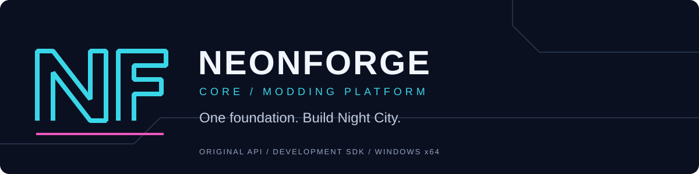

# NEONFORGE Core

[](https://github.com/Hitie/neonforge/actions/workflows/windows.yml)
[](https://github.com/Hitie/neonforge/actions/workflows/codeql.yml)
[](LICENSE)

[Feature status](docs/status.md) · [API](docs/api.md) · [Roadmap](docs/roadmap.md) · [Contribute](CONTRIBUTING.md) · [Security](SECURITY.md)

**One foundation. Build Night City.**

An original Cyberpunk 2077 modding-platform project with a new API for mod authors. The long-term target brings native plugins, scripting, database edits, resources, game services and developer tools into one package.

**Current build: 0.1.5 development SDK.** The standalone native runtime, Lua layer and developer tools work. Game hooks, TweakDB, resource extensions, the game-script compiler and game UI are not implemented yet. This build does not replace ArchiveXL, Cyber Engine Tweaks, TweakXL, RED4ext, Codeware or redscript. It has not been tested inside Cyberpunk.

## Working now

- Original [offline typed data engine](docs/data-model.md), atomic record batches, immutable snapshots and conflict provenance.

- Typed values, signature lookup and checked native calls with caller-owned results; see [typed API](docs/typed-calls.md).
- Isolated Lua states with typed calls, owned callbacks, local modules and bounded reloads; see [scripting](docs/scripting.md).
- Native Windows x64 DLL host and C ABI, with C and C++ example mods.
- Strict manifests, semantic versions, dependency ordering and unavailable-capability checks before plugin startup.
- Owned callbacks and deferred tasks, safe callback-list mutation, cancellation and closing/release states.
- Versioned services with explicit leases that prevent providers from unloading while referenced.
- Exact JSON settings preservation, atomic replacement and per-mod storage.
- Bounded structured logs, callback timings, per-mod resource counts and error counters.
- Indexed event routing and direct task cancellation, with a real-DLL [performance benchmark](docs/performance.md).
- Package inspection, dry-run installation, ownership receipts, modified-file preservation and rollback after ordinary I/O failures.
- Versioned settings migration, native project generation and exact-build diagnostics.
- A Windows system-library probe for future bootstrap work. It is not a game bootstrap.

See [feature status](docs/status.md), [SDK contracts](docs/api.md), [development](docs/development.md) and [package tools](docs/tools.md).

## Run the binary SDK demo

Open [Actions](https://github.com/Hitie/neonforge/actions/workflows/windows.yml), choose a successful run and download its SDK/source artifact. Development artifacts expire after 14 days and require GitHub sign-in. Extract the SDK candidate and double-click `Run-Demo.cmd`, or run:

```powershell
.\runtime\neonforge.exe validate .\examples\mods
.\runtime\neonforge.exe run .\examples\mods .\data --ticks 3
```

Run `Run-Data-Demo.cmd` for the original declarative data project.

Run `Run-Typed-Demo.cmd` for the C signature-lookup and typed-call example, or `Run-Lua-Demo.cmd` for the original Lua provider/consumer packages.

The original provider and consumer plugins exchange a versioned math service, receive a ready event, run a deferred task and persist results. This runs in a standalone process. Do not copy this SDK candidate over your game loaders.

## Build the source

Use Windows x64, an installed MSVC C++20 toolchain, CMake 3.25+ and Python 3.10+ for developer checks:

```powershell
cmake -S . -B build -A x64 -DPython3_EXECUTABLE="C:/path/to/python.exe"
cmake --build build --config Release
ctest --test-dir build -C Release --output-on-failure
```

`build.ps1` is an alternative for the tested Visual Studio 2026/Windows SDK installation. Pass `-Python` explicitly where the Python launcher cannot access installation metadata. The runtime itself does not require Python. See the development guide for environment limits and test scope.

## Original implementation and compatibility

NEONFORGE uses an original API. Existing mods will need porting; unchanged compatibility with the six reference frameworks is not promised. No framework implementation, SDK header, game executable, game script blob or game asset is included. Ordinary infrastructure dependencies will retain their own notices if added. The original adapter uses C/C++, the Windows API and Python's standard library, with pinned Lua 5.5.1 embedded as an attributed infrastructure dependency. See [third-party notices](THIRD_PARTY_NOTICES.md).

No claim of being faster or more compatible than every existing core is made from standalone tests. Game support will be published per feature, exact executable and test scenario.

## License

The repository's existing [GNU GPL version 3 license](LICENSE) is preserved. Original NEONFORGE project code is provided under that license. Windows/MSVC components and Cyberpunk remain their respective owners' software and are not bundled with the source.

Project repository: [Hitie/neonforge](https://github.com/Hitie/neonforge).
